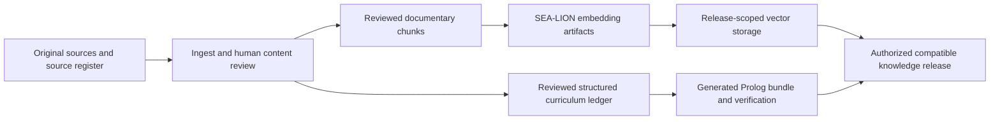
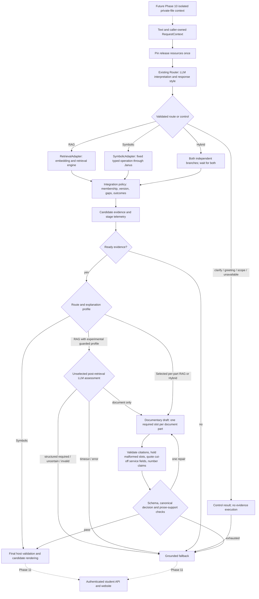

# Developer pipeline map

Read this after [AGENTS.md](../../AGENTS.md) and the [phase index](../../plans/INDEX.md).
The [master plan](../../plans/master_implementation_plan_original_long.md) defines
the intended system; this guide maps it to code and states what runs today.
For algorithm code and a runnable paper demonstration, open
[backend/algorithms](../../backend/algorithms/README.md) and the detailed
[algorithm map](algorithms.md).

Phase08 delivers **internal candidate orchestration with synthetic release
injection**. Phase09 adds candidate generation/validation; see the
[model observations](../../plans/2026-10-19-phase09-observation-status.md) for measured
results and remaining limits. The default provider holds execution. There is
no student chat endpoint, institutional release loader or deployment.
Source authority/currentness, held fields and hosted migration gaps remain open.
The existing 75 accepted institutional question variants were not rerun here.

The [actual service runner](../../backend/bintanong_runtime/README.md) now composes
these modules for a checked fictional local release. All three routes have actual
model/service observations in the [delivery report](../../plans/2026-10-20-live-backend-composition-results.md).
This proves the internal paths on controlled fixtures; latency,language/prose scope
and institutional loading remain open. Phase09 is active;Phase10 has not started.

The current [question-understanding recovery](../../plans/2026-10-20-router-understanding-implementation-plan.md)
requires interpretation/integration/answer v2. It binds requested parts from the
pre-evidence router through the existing support call and host canonical results.
Software verification is separate from actual model quality;the earlier service
observations above do not validate this new candidate. No added classifier call,
new latency result,student endpoint or institutional activation is implied.

## Two separate pipelines

Institutional preparation happens outside student requests. Private uploads and
conversation facts never update it.



The release box is a required authorization boundary. Having candidate files,
matching IDs, parser success or a synthetic test result does not pass that boundary.

| Preparation responsibility | Code / evidence entry point |
| --- | --- |
| Source intake, originals, review holds | [Storage](../../backend/bintanong_storage/README.md), [scope](../../plans/undergraduate-scope-policy.md), [gaps](../../plans/source-gap-policy.md) |
| PDF ingestion and curriculum extraction | `backend/bintanong_tools/document_ingest/`, `backend/bintanong_tools/prospectus_extractor/` |
| Embedding preparation | `backend/bintanong_embedding/` |
| Versioned storage and release controls | `backend/bintanong_storage/`, `supabase/migrations/` |
| Structured authoring, compiler and Janus runtime | [Symbolic module](../../backend/bintanong_symbolic/README.md) |

The student request pipeline has one release pin and one validated route. An LLM
selects the route; host code checks identities, arguments and evidence boundaries.



No extra orchestration framework, queue or graph service is needed. The control
flow is ordinary async Python in `Orchestrator.run` and `AnswerPipeline.run`. API composition is later work;
the existing FastAPI app exposes health probes only.
The experimental post-retrieval assessment failed multilingual quality and remains
unselected; the default per-part profile follows the documentary path, with one
required answer slot per declared document part. The assessment
does not change the original route or execute rules.
Only a document-only result proceeds; other results withhold the structured answer.
Its one call and timing are recorded separately from draft/support attempts.

## Where to make a change

| Responsibility | File / module |
| --- | --- |
| Canonical vector math, generic Prolog engine and paper demo | [Algorithms folder](../../backend/algorithms/README.md) |
| Request stage order, dispatch and total stage deadlines | [orchestrator.py](../../backend/bintanong_orchestration/orchestrator.py) |
| Release provider and typed dependency interfaces | [ports.py](../../backend/bintanong_orchestration/ports.py) |
| Candidate snapshot, evidence and telemetry schemas | [contracts.py](../../backend/bintanong_orchestration/contracts.py) |
| Release consistency and permitted conclusion scope | [integration.py](../../backend/bintanong_orchestration/integration.py) |
| Existing retrieval/Prolog translation and worker admission | [adapters.py](../../backend/bintanong_orchestration/adapters.py) |
| Candidate drafts, support checks, canonical rendering and one repair | [Generation module](../../backend/bintanong_generation/README.md) |

Research procedure coverage can now travel from the source-aware assessment's exact
reviewed `client_step` field records through `RetrievalAdapter`, `DocumentResult`,
multi-topic merge and `PreparedEvidence`. The per-part generator checks its own
claims' citations against the requirements for that exact subject/claim before
review; final validation repeats the floor. Missing coverage gets the existing
single repair, then withholding. This establishes record citations only; semantic
completeness, source gaps and action/office association still require review.
The model's completeness check receives all documentary cards as context, while
individual claim support remains limited to its own cited cards. No Prolog result
or private file enters that documentary context, and no release is activated.
| Semantic routing, aliases, claims and language metadata | [Routing module](../../backend/bintanong_routing/README.md) |
| SEA-LION query embedding, source selection and context assembly | [Retrieval module](../../backend/bintanong_retrieval/README.md) |
| Reviewed facts, generated rules, fixed goals and deterministic reasoning | [Symbolic module](../../backend/bintanong_symbolic/README.md) |

Keep policy data in the reviewed authoring ledger and generated bundle. Do not add
course-specific prerequisite rules to the orchestrator, keyword routing, a second
student fact database or a vector lookup for every exact curriculum question.

## Route and result contract

RAG returns documentary passages with source byte hash, version, page and locator.
Symbolic returns a scoped `SymbolicResult`, or `DependencyResult` for
`list_affected_courses`; the latter is a potential dependency listing, not an
eligibility verdict. Hybrid requires both documentary and symbolic components.
An exact source locator can support a symbolic explanation without vector search.

Every completed route returns `CandidateEvidence` inside `IntegrationResult`.
`permitted_scope` names the synthetic check/explanation that completed. All results
carry `candidate_only=true`, `institutional_use_allowed=false` and
`activation_allowed=false`. These contracts intentionally remain separate from
the institutional `EvidenceBundle`/`AnswerEnvelope`, which reject offline research
results. A ready synthetic fixture establishes no real student entitlement.

| Outcome | Meaning / allowed behavior |
| --- | --- |
| `ready` | Required synthetic branches completed with matching membership/version and no reported gaps; use only the named scope |
| `unknown` | Missing facts, rule coverage or incomplete dependency listing; no definitive eligibility |
| `clarify` | Required target/scope or model interpretation unresolved |
| `greeting`, `unsupported_scope`, `evidence_unavailable` | Router control; no evidence executor runs |
| `no_evidence`, `uncalibrated` | Retrieved context does not establish answer readiness |
| `conflict` | Reported source or symbolic contradiction; conclusions withheld |
| `release_mismatch` | Stale release, wrong bundle or evidence outside pinned membership |
| `unsupported`, `error` | Preserved symbolic operation/operational result; no policy conclusion |
| `held`, `timeout`, `busy`, `invalid_output`, `tool_error` | Execution cannot complete; no substitute route or parametric institutional answer |

Operational failures return no partial evidence package. When both components
return typed observations but one is not ready, the package preserves them with
`permitted_scope=none`. Downstream code must never treat a retained successful
component as permission to answer the failed combined request. Detected conflicts
are supplied by upstream policy/runtime checks; this code does not semantically
compare arbitrary document prose with Prolog rules.
When typed branches disagree on failure status, the precedence is release mismatch,
conflict, error, unsupported, unknown, clarification, no evidence, then uncalibrated.
Both component observations remain available; a lower-priority hold cannot conceal
a symbolic conflict or operational failure. Router timeout/transport/invalid-output
diagnostics retain their operational classification rather than becoming controls.

## Follow-ups, ownership and private context

The caller must authenticate session ownership before constructing `RequestContext`.
The pipeline validates consistency; it does not authenticate users or expire sessions.
For a follow-up, pass only the owning session's explicit program/curriculum and
scoped facts. Missing grades remain unknown. New asserted claims may enter this
request's Prolog arguments; hypothetical/reported claims cannot. There is no hidden
history, automatic fact persistence, implicit course-target reuse or transcript
completeness inference. A target like "that one" needs clarification when unresolved.

Ownership, expiry and confirmation now exist (Phases 10 and 11). `SessionStore` (memory only, 30 min idle)
holds confirmed facts, at most one pending upload and the previous turn's ids. `follow_up_context` passes only
facts in the request's own program/curriculum. Private file extraction runs in a bounded child process
(`worker.py`). It never becomes a source catalog entry or institutional rule.

## HTTP API (Phase 11, backend only)

`backend/bintanong_api/app.py` `create_app(ApiServices, ApiSettings)`. Run one worker process: sessions are
process memory.

| Endpoint | Behaviour |
| --- | --- |
| `POST /chat` | AI SDK UI message stream v1 (`x-vercel-ai-ui-message-stream: v1`). Only the last user message is used. Transient `data-status` progress, then one validated student text, `source-document` parts, `data-answer` (`status`, `conditional`), `finish`. 422 before the stream (including `invalid_message` for text the router's `prepare_query` refuses); `error` chunk with a fixed code after it. One turn per session (409 `chat_in_progress`, `already_answered`, `session_ended`); a disconnect cancels the turn and captures nothing. |
| `POST /uploads?programId=&curriculumId=` | Raw body, capped and sniffed by its leading bytes only; all PDF/image parsing and extraction run in the child job (`extract_rows` receives raw bytes); returns pending rows (printed code, course labels, marks). Photos return `photo_ocr_unavailable`. More than `max_parallel_uploads` (default 2) at once return 503 `uploads_busy`. |
| `POST /uploads/{id}/confirm`, `DELETE /uploads/{id}` | The student's row choices become session facts; delete removes the upload's facts. |
| `GET /sources/{source_id}` | A card cited by this process's answers: title, page, section, readable excerpt. |
| `GET /curricula`, `DELETE /session`, `GET /health/*` | Picker list; forget the session and clear the cookie; health. |

- Cookie `__Host-bintanong_session`: HttpOnly, Secure, SameSite=Strict.
- At the 1000-session bound, the least recently used empty session (no facts, pending rows, conversation or
  running turn) is evicted; only when every session holds student state is a new one refused (503
  `session_limit`). Per-client rate and body-size limits belong to the deployment proxy
  ([security review](../../plans/2026-10-24-phase-11-security-review.md)).
- `/health/ready` failure reasons are fixed text without exception details.
- Answer admission (owner, 24 Oct): `max_running_answers` (default 1, matching Gemma `--parallel 1`) run at once;
  up to `max_waiting_answers` (default 4) wait with a transient `data-status` stage `waiting`; more get 503
  `answers_busy` before any stream. Answer timeouts start only once a turn runs.
- Unsafe methods need an allowed `Origin` and no `Sec-Fetch-Site: cross-site`.
- Students see `presentation.student_text`. The canonical `CandidateAnswer.text`, which the validator checks byte
  for byte, stays the researcher diagnostic.
- `research_pipeline.ResearchPipeline` adapts the real answer path. The real-data launcher (hosted release, encoder,
  model URL) is a trusted script kept in ignored workspace evidence.

## Resource and telemetry behavior

Each stage has a finite `stage_timeout` (default120s, configurable up to300s).
Retrieval's stage covers embedding plus storage; it does not report separate embedding
and SQL durations. Preserve existing storage transport timeouts and Prolog's own
bounded subprocess/admission limits. Phase09 adds a generation deadline and reduces
its budget by time already spent in the composed request's orchestration.
The adapters admit one worker each and return `busy` under overlap. Hybrid branches
start concurrently only after independent inputs are ready; cancellation propagates
to async branches. Cancelling an async wait cannot kill its running thread: adapter
admission remains held until that worker finishes. Avoid retrying by creating fresh
adapters; share the bounded instances in the release resources.

`StageEvent` contains only stage, duration, route, release ID, outcome, retry count
and evidence IDs. Raw text, prompts, facts, grades, session IDs and exception bodies
are absent. The returned evidence is request-private; never log the entire result.
There is no automatic telemetry exporter or external logging in this module.

## Verify and extend

From the repository root in the prepared Python3.13 environment:

```powershell
$env:TEMP='C:/Coding-projects/bintanong_workspace/audit-evidence/p08-local-tests'
$env:TMP=$env:TEMP
New-Item -ItemType Directory -Force $env:TEMP | Out-Null
python -B -m pytest -q -p no:cacheprovider --basetemp=$env:TEMP/run tests/test_orchestration_integration.py tests/test_orchestration_adapters.py tests/test_orchestration_pipeline.py tests/test_orchestration_sessions.py tests/test_orchestration_smoke.py
```

The [smoke fixture](../../tests/test_orchestration_smoke.py) is the complete synthetic
composition recipe: actual Router, RetrievalEngine and Janus; scripted model output,
manual embedding vector and synthetic database responses. It measures integration
mechanics, not multilingual accuracy or institutional source quality. No model/DB
service is required; the prepared environment needs the existing Janus/SWI runtime.

Before institutional composition, implement an authorized release loader with actual
membership, source authority, scope, recency, rule review and compatible embedding
identity checks. Reconcile the [hosted migration gap](../../plans/2026-10-19-hosted-migration-status.md).
Then honor the applicable phase/release gates. Do not flip a synthetic flag to bypass
them. Phase09 candidate code consumes revalidated evidence, preserves unknowns and checks claims,
citations and response language. Phase07's two Taglish style errors remain; passing
metadata through is not proof of answer-language quality. The standing
[prompt decision](../../plans/2026-10-19-prompt-engineering-and-validation-decision.md)
still applies: inference guidance/guards, no parameter training and a one-week cap.
