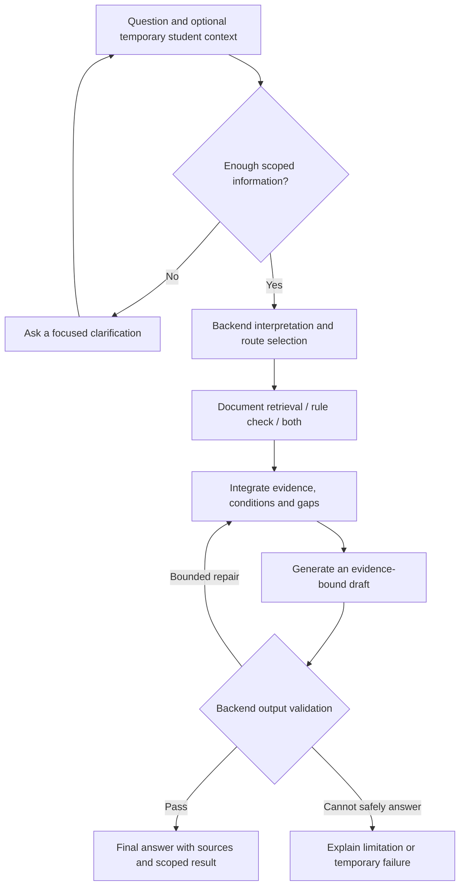

# Frontend feature and integration map for Figma

13 October 2026, Asia/Manila. Repository analysis and design recommendations, not an approved UI specification or implementation plan. Student-facing product code is unchanged.

## 1. Baseline and intended outcome

The owner will design the UI in Figma and wants to understand the pipeline/backend first. Frontend work follows `dev`. The design must cover actual academic-guidance workflows, preserve the thesis boundaries, and minimize conflicts with backend development.

Verified baseline:

- Checkout: `C:/Users/Hawksprey/source/repos/Bintanong`, branch `frontend`, HEAD `59724f13eff9fcfdc286ee7d4c6dcd6d89298e48`.
- Local `dev` and live `origin/dev`: `b0ba6d496bf5df6656fc1d743469c2fdca262957`. Live remote refs checked with `git ls-remote`; GitHub MCP also read `frontend/package.json` on `dev`.
- `dev` is an ancestor of `frontend`. The only branch difference before this analysis is an empty root `DESIGN.md`. `frontend/` and `backend/` have no differences from `dev`.
- Formal Phase 05 is still blocked. Candidate software, merged branches and owner transcription confirmations do not establish an approved institutional release or a completed student runtime. This analysis does not start Phase 11 or advance the phase ledger.
- Phase 05's checkpoint records a separate retrieval/source-review workstream. A different frontend branch HEAD is not, by itself, a reason to rewrite that phase's checkpoint. The owner's follow-up clarifies that this is preparation for the master plan's Phase 11 interface, not Phase 05 work or a formal Phase 11 start. The earlier checkpoint edit in `e3d1160` was unnecessary and has been reversed on the owner's explicit instruction, restoring its exact pre-edit contents. Do not edit `phase-05-checkpoint.md` again without first clarifying the reason with the owner.

## 2. Evidence consulted and precedence

1. Current repository code and Git, including frontend files, API routes/client, shared contracts, retrieval types/README, institutional ingestion entry points and implementation decisions.
2. [Undergraduate scope](undergraduate-scope-policy.md), [source gaps](source-gap-policy.md), and [service-table associations](service-table-association-policy.md).
3. [Master plan](master_implementation_plan_original_long.md), especially sections 1–4, 6–16 and 18–22: authority, preparation/runtime separation, contracts, retrieval, reasoning, routing, validation, private context and interface integration.
4. [Thesis](../Context/bintanong_thesis_for_context.pdf), physical pages 13–15, 17–20, 55–56, 59, 65–66 and 68–79. Physical 17–18 (printed 16–17) and physical 66 were also rendered and visually inspected. The PDF contains 88 physical pages; references here use physical positions.
5. [Runtime routing PNG](../Context/bintanong_full_runtime_routing_architecture.png), visually inspected: interpretation → LLM router → RAG/Symbolic/Hybrid → integration → generation → validation → student output; failed validation returns to integration.
6. [Ledger](INDEX.md), [current progress](plan_current_progress/current_progress.md), Phase 05 plan/checkpoint/blocked handoff and previous complete Phase 04 handoff; [ingestion documentation](ingestion/README.md), current delivery snapshot and private lifecycle draft.

Reconciled discrepancies:

- Thesis physical 59 describes preliminary generation before symbolic validation. The PNG and master sections 1.3/3/13/14 govern the selected flow: obtain required symbolic results, integrate, generate, validate, then render.
- Thesis stack table mentions student-related storage; physical 65–66 and master sections 1.3/9/15 establish the stricter boundary: no persistent personal academic records or personal chat transcripts in institutional storage.
- Master section 20's `backend/app/...` paths are proposed ownership boundaries. Actual packages are `backend/bintanong_contracts`, `bintanong_retrieval`, `bintanong_storage`, `bintanong_embedding`, `bintanong_api`, and tools. Use actual paths when integrating.
- Ingestion's 11 October snapshot contains historical phase/source-delivery statements. The current ledger/checkpoint and Git supersede them; do not restart delivered ingestion or infer readiness from that snapshot.
- Root `DESIGN.md` is empty. No palette, typography, visual identity or final layout has been established by that file. This report supplies functional constraints for the owner's Figma design, not invented brand direction.

## 3. What exists on dev versus what is planned

| Surface | Current code evidence | UI consequence |
| --- | --- | --- |
| Browser app | `frontend/app/page.tsx`: client compatibility dashboard, polls `/api/health` every 10 seconds | Existing page is developer infrastructure, not the target student experience |
| Web boundary | `frontend/app/api/health/route.ts`: server proxy to FastAPI `/health/ready` using `API_INTERNAL_URL` | An existing server-boundary pattern to follow; no chat/upload proxy yet |
| Frontend stack | `frontend/package.json`: Next 16.3.5, React/React DOM 19.3.0, TypeScript 7.0.2; plain `styles.css` | AI SDK, shadcn/ui and Tailwind are selected in the thesis/master but are not current dependencies; no install authorized by this analysis |
| FastAPI | `backend/bintanong_api/main.py`: only `/health/live` and `/health/ready` | No delivered `/chat`, `/uploads`, `/session` or `/sources` interface |
| Legacy LLM routing client | `backend/bintanong_api/bintu_client.py`: route call and legacy RAG/Hybrid/Symbolic/Direct schema | A client primitive, not the complete validated runtime; do not build four student mode tabs from it |
| Shared contracts | `backend/bintanong_contracts/{runtime,answer,symbolic,governance}.py` | Reuse status, evidence and decision semantics; an HTTP/stream projection is still needed |
| Retrieval | `backend/bintanong_retrieval`: strict query encoder, release/scope checks, context assembler and internal debug CLI | Evidence retrieval exists independently of chat generation; its debug payload is not a browser API |
| Institutional preparation | `backend/bintanong_tools/document_ingest`, embedding/storage packages and inactive rule candidates | Researcher workflow; ordinary students cannot ingest or activate knowledge |
| Source review GUI | `backend/bintanong_tools/prospectus_review_gui` | Separate local preparation tool, not a student portal or a delivered hosted reviewer dashboard |
| Full reasoning/chat/private runtime | Later formal phases; private lifecycle architecture remains a draft with unresolved cleanup risk | Figma can cover target states, but implemented connectivity/security must not be implied |

Source review, effectivity/applicability, approved development retrieval/calibration and runtime integration remain distinct gates. A healthy component probe does not prove that a supported academic question can be answered.

## 4. How the pipeline becomes a student interaction

### Institutional preparation happens outside chat

Authorized originals → source register/version/hash → Docling/OCR → reviewed spans, tables and chunks → SEA-LION embeddings → restricted Supabase release storage. Separately, reviewed clauses/curriculum become approved structured rules and a compatible Prolog bundle. A release binds the document, embedding and rule versions.

The UI receives permitted evidence and outcomes from that release. It does not run OCR on the institutional corpus, build embeddings, author Prolog, choose thresholds, approve sources or publish a release. A student's upload never enters this preparation path.

### Request lifecycle

This is a conceptual interaction map, not an implemented event protocol. Ownership, size limits and scope checks also apply around each operation.

| Backend path | Student's goal | UI output needed |
| --- | --- | --- |
| RAG | Understand an authorized policy or student-facing procedure | Explanation, linked source passages, complete relevant conditions and known limitations |
| Symbolic | Check a supported prerequisite/condition against confirmed facts | Scoped result, satisfied/unmet/unknown conditions, assumptions and rule sources |
| Hybrid | Understand both a check and documented next steps | Result and explanation together, with evidence for both required paths |
| Control outcome | Missing context, unsupported request, greeting or unavailable evidence | Clarification, scope explanation, evidence limitation or recovery action |

The backend selects the route. Students ask in English, Filipino or Taglish. They should not need a RAG/Prolog selector, raw predicates, chain-of-thought, similarity scores or model-confidence percentages. The legacy `Direct` route is explicitly refused by `routing_adapter.py`; its control mapping is still an open decision.

## 5. Recommended product shape

Choose **one conversation workspace with contextual panels**. A citation opens source details; clarification opens a dialog over the current workspace; fact confirmation remains part of the current task; temporary files/context have a manageable panel. This maps naturally to the shared answer contract and avoids duplicating behavior across academic modules.

Owner-selected clarification interaction: use a Codex/Claude Code style popup with selectable options and a chance to explain. Present one focused question, concise relevant choices, and a free-text explanation field that can accompany a choice or supply an alternative answer. Use an explicit submit action; neither a preselected choice nor closing the popup counts as an answer. Include an unknown option when appropriate, preserve the current task when dismissed, and keep unresolved facts unresolved. Choices must come from supported context rather than invented curriculum options. The dialog needs keyboard navigation, labeled controls, focus management and a usable mobile layout. The exact visual styling remains the owner's Figma decision.

The system specifications determine when the popup is needed and what it asks; the Codex/Claude Code reference supplies the interaction style. Map it to the existing semantics:

- `NormalizedQuery.ambiguities` and `RoutingDecision.control == "clarify"` / `missing_facts` identify unresolved meaning or required context. Ask only what the current supported task needs; a question with sufficient context does not need a popup.
- Supported canonical entities and applicable source versions constrain program/course/curriculum choices. If grounded options are unavailable, allow a free-text answer or “I don't know”; do not fabricate a catalog or guess the answer.
- Private extraction review follows `SessionFact.confirmation_state`. Preserve the displayed extracted value and student explanation; only explicit confirmation can support the corresponding confirmed fact. Both choices and explanations are untrusted input for backend validation. A contradictory explanation must remain unresolved rather than silently losing to the selected option.
- A student can clarify their context, but cannot establish institutional policy authority by selecting an option. Source gaps, missing rules and conflicting institutional sources still require the specification's limited answer, abstention or supported referral. Do not ask students to choose which unsupported policy is true.

These are UI requirements mapped to existing contracts and master sections 12/15/16. The public clarification/options transport remains to be agreed under section 8; no such endpoint or runtime behavior is claimed as delivered.

Alternatives considered:

- A multi-page policy/course/standing dashboard offers direct navigation, but implies structured catalogs and summary endpoints that are not delivered. It also risks collecting a persistent academic profile. Revisit only for an explicitly supported workflow.
- A bare chat box is smaller visually, but insufficient unless it still supports source inspection, fact confirmation, missing information, file clearing and failure states.

Suggested information architecture: student workspace, source-detail overlay/panel, temporary-context panel, and compact scope/privacy/help information. These can be states of one route rather than separate pages. Keep the compatibility dashboard as a distinct developer surface when the student entry page is eventually implemented; any move of its route needs coordination.

## 6. Frontend features to represent in Figma

All rows below describe target design requirements or recommendations; they are not claims that the current frontend implements them.

| Feature | What the student can do/see | Backend dependency and boundary |
| --- | --- | --- |
| Start and ask | Enter a multiline question; see supported scope/languages and a small set of relevant example questions | Future session/chat boundary; examples are prompts, not asserted PalSU rules |
| Curriculum context | Supply or correct program/campus/curriculum edition/course when the question requires it; choose “I don't know” | Backend resolves canonical identities and ambiguity; never assume an edition from current year alone |
| Clarification | Answer a focused question in an options-based popup, add an explanation or alternative free-text answer, and continue the same task | `RoutingDecision.missing_facts`, normalized ambiguities and future chat continuation protocol; submit the selected option and explanation together without inferring an answer from dismissal |
| Policy answers | Read grounded explanations about grade policies, standing, discipline and student-facing services | Only applicable, approved content; absence of a policy is an evidence limitation |
| Prerequisite checks | See the supported check's result, assumptions and unmet/unknown conditions | Future approved capability/runtime; `DecisionOutcome` supplies semantics, not an enrollment authorization |
| Documented procedures | Follow ordered student steps with linked agency sub-actions, time, responsible role/office, conditions and fee provenance when available | Preserve service-table associations and page continuations; blank fields remain unknown, not free/zero |
| Processing feedback | Understand that the system is checking sources/conditions or validating its response | Future backend progress events; show actual stages only, no fabricated percentages or completion times |
| Sources | Open source title/edition, physical page and printed label where available, section/table locator and permitted excerpt/link | Future authorized source projection; source metadata is richer than current `Citation` alone |
| Private PDF/photo input | Attach supported PDF/JPEG/PNG, see pending/conversion/failure states and remove context | Future verified ownership, media/size/page limits, isolated conversion and cleanup; currently unavailable as a product API |
| Confirm extracted facts | Review consequential course codes/values, correct/reject uncertain facts, then explicitly confirm | `SessionFact` origin/confirmation; frontend cannot mark a student fact as an official university record |
| Conditional conclusions | See which result depends on student-provided information | Canonical decision plus confirmed private facts; always limited to the check actually performed |
| Clear session | Explicitly clear temporary conversation/context and see success, pending or failure | Future deletion/expiry contract; clearing a local component alone does not establish server deletion |
| Recovery | Recover from unavailable evidence, source conflict, service failure, disconnect or expiry without a false result | Typed control/error information, request identity and eventual retry/cancellation semantics |
| Responsible-use notice | See that Bintanong is an AI academic guide and important decisions need verification with the relevant university office/advisor | Thesis physical 66; keep it visible without obstructing every interaction |

Do not make a full student profile form mandatory before a general policy question. Request only the context relevant to the task. A language preference control is optional; multilingual entry and readable replies are required regardless.

## 7. Figma frame and variant checklist

Create a desktop workspace and a narrow mobile version, then reuse components for the following states. These are a functional inventory, not a prescribed visual style.

| ID | Frame or variant | Essential contents |
| --- | --- | --- |
| F01 | Empty workspace | Purpose/scope, English/Filipino/Taglish guidance, composer, attachment entry, responsible-use notice |
| F02 | Sending/processing | Submitted question, truthful progress, disabled duplicate submission, accessible status announcement |
| F03 | Policy answer | Final explanation, sources, limitation/next-step area when applicable |
| F04 | Supported check passes | “Conditions met for this check,” confirmed assumptions, satisfied conditions, sources; no “enrollment approved” |
| F05 | Supported check fails | Proven unmet condition, source and documented next action; no invented alternative or exception |
| F06 | Clarification popup | Missing program/edition/course/fact prompt, selectable choices, explanation/alternative text field, explicit submit, unknown option where relevant, and dismissed/unanswered variant |
| F07 | Insufficient evidence/source gap | What can be supported, what is unavailable, supported office referral if known; no fabricated process end |
| F08 | Conflicting sources | Scope/edition issue and withheld conclusion; similarity does not choose the authoritative policy |
| F09 | Out-of-scope/unsupported | Concise scope/capability explanation and a useful way to reformulate; distinct from a network failure |
| F10 | Source details | Title/version, page/section/table, relevant excerpt, known gap, authorized link or unavailable-link state |
| F11 | Attachment lifecycle | Selected, validating, processing, rejected format/size/pages, unreadable, failed, unavailable and removed variants |
| F12 | Fact review | Extracted course/value/context, uncertainty, source origin, edit/reject/confirm and dependent-result warning |
| F13 | Temporary context | Current facts/files, confirmed versus unconfirmed, per-upload removal and clear-session entry |
| F14 | Clear/expiry | Clear confirmation if needed, deleting, cleared, deletion not confirmed, expired session and re-entry |
| F15 | Operational failure | Timeout, disconnected, busy/unavailable, failed final validation, retry state and retained/expired draft as appropriate |
| F16 | Procedure answer | Ordered logical steps; agency action/time/person/office stay together; shared fees and incomplete-source notice |

Useful prompt families: enrollment procedure guidance, prerequisite questions, grade-policy explanations, academic-standing guidance and disciplinary-policy explanations. Availability depends on approved source/capability coverage. Do not prefill realistic grade thresholds, fees, sanctions or prerequisite relationships without an authorized source. Use clearly synthetic mock content in Figma.

Mobile and accessibility requirements: keyboard-visible focus, labeled attachment/remove controls, readable text and tables, status announcements, no reliance on color alone, focus return from panels/dialogs, and a composer usable with the phone keyboard open. Source and context panels can become sheets or full-width views on mobile. Keep the same semantic result states across sizes and languages.

## 8. State semantics and existing contract gaps

### Reuse the existing answer vocabulary

`AnswerEnvelope` (`backend/bintanong_contracts/answer.py`) currently carries `request_id`, `status`, `language`, `text`, `route`, `decision`, `citations`, and `validation`, plus its schema version. Its exact statuses are:

| Contract value | UI meaning | Limit |
| --- | --- | --- |
| `answered` | Validated, source-backed final answer | Does not imply a positive decision; `ineligible` is also an answered result |
| `clarification_needed` | Ask for information needed to continue | Unknown facts are not a failed prerequisite |
| `abstained` | Explain why a supported answer/check cannot be given | UI subtypes such as source conflict versus out of scope need additional agreed metadata |
| `error` | Operational failure | Never render as a policy denial; contract disallows citations and passed validation on an error |

`DecisionOutcome.outcome` has five distinct values: `eligible`, `ineligible`, `unknown`, `unsupported`, `error`. Preserve them. A missing course record, absent prerequisite rule, unconfirmed extracted fact or incomplete rule coverage cannot produce either eligibility or ineligibility by default.

`EvidenceBundle` rejects partial Hybrid evidence, mixed release identity and definitive decisions from unconfirmed private facts. These validators exist, but do not establish a delivered orchestrator, complete prose-support validation or safe browser streaming.

### Agree these boundaries before connecting the UI

1. **Public request/session transport:** no delivered chat request DTO, session issuance/credential transport, clarification continuation, progress stream, cancellation or request deduplication contract. The frontend must not invent authorization from a session ID.
2. **Progress versus answer:** stream status events if supported; release final answer content only after backend validation. AI SDK is not installed, and arbitrary FastAPI SSE must not be assumed compatible with its future pinned transport.
3. **Control/error projection:** the master describes richer outcomes than the four current envelope statuses. Agree stable reason codes and recovery actions for evidence gaps, source conflict, out of scope, service unavailability and expired sessions. Do not silently expand the Python enum from UI code.
4. **Citation enrichment:** current `Citation` has `chunk_id`, `byte_sha256`, `version_id`, `page`, `locator_ref`; it does not contain title, excerpt, printed page label or public URL. Define an authorized lookup/projection and how the proposed `/sources/{source_id}` identifier relates to existing IDs. Internal filesystem paths are not browser links.
5. **Retrieval adaptation:** `bintanong-retrieval-debug-v1` is internal and can retain conflicting editions. Public `RetrievalResult` rejects competing editions. Preserve conflict/coverage outcomes through an explicit adapter; do not cast the debug payload into the public model or treat debug `ok` as an answer.
6. **Fact confirmation:** define review/edit/reject/confirm requests, provenance and invalidation of dependent results. The UI must not decide confirmation authority or directly mutate institutional rules. Plain text input also needs an agreed confirmation flow where a definitive check relies on it.
7. **Private lifecycle:** final limits, session TTL, cleanup readiness and deletion acknowledgments remain decisions to close. Master 30-minute idle lifetime and lifecycle-draft limits are proposals, not final UI promises. The known cleanup High remains open; do not promise immediate erasure from a successful local removal animation.
8. **Release changes and late results:** retrieval can return `release_changed`; future orchestration must repin/retry within its authorized policy. Keep citation and result bound to one request/release. Changing curriculum context, deleting an upload, clearing/expiring a session or cancelling work must prevent stale results from appearing as current.

For Figma, annotate unavailable integrations and represent unknown/pending variants now. For implementation, use synthetic fixtures that match the agreed public contract; label mocks and keep them out of production data paths.

## 9. Keep frontend work aligned with dev

Owner preference: `frontend` and `dev` develop side by side as branches/workstreams of one system. Their changes may diverge while features are in progress; they share the system specifications and coordinated interfaces. Frontend work follows dev's applicable backend behavior without requiring identical branch trees at every moment. This is parallel development, not a separate product fork or a requirement to wait for the entire backend before designing the UI.

| Ownership | Likely files | Coordination rule |
| --- | --- | --- |
| Student presentation | `frontend/app`, future focused conversation/source/context components | Frontend owns layout, responsive behavior, accessibility and rendering of agreed states |
| Typed web adapter | Future frontend transport/types and Next.js API boundary | Agree with backend owner before implementation; one projection rather than per-component guesses |
| Runtime and evidence | `backend/bintanong_api`, shared contracts, retrieval, future orchestrator/private lifecycle | Backend owns authorization, source/release applicability, decision execution, validation and cleanup |
| Institutional preparation | Ingestion, review GUI, embedding/storage migrations and rule candidates | Keep outside student design/implementation patches |
| Shared integration hotspots | `frontend/package.json`, lockfile, root layout/global styles, API contracts, Compose/env configuration and phase logs | One owner per change; communicate dependency/setup edits before parallel work touches them |

Practical branch workflow:

1. Refresh remote refs and compare `frontend` against `origin/dev` before each implementation slice. At this snapshot the product trees already match; no merge was needed or performed.
2. Start new frontend feature branches from an agreed dev baseline; continue the existing `frontend` branch alongside dev using separate working directories/worktrees when both are being edited. Integrate focused, verified changes at agreed boundaries. For an already published/shared `frontend` branch, merging `origin/dev` preserves shared history; do not rewrite it with a force push as a routine synchronization step.
3. Review upstream contract/config/dependency changes before merging, then update the adapter and affected fixtures in the same coherent slice. Keep one coordinated public contract and explicit synthetic mocks for endpoints still under development; do not let frontend and backend invent incompatible versions independently. Avoid copying backend files into the frontend branch as substitutes for integration.
4. Keep Figma-generated presentation code in `frontend/`. Do not regenerate package/lock/config/backend files wholesale. Map Figma components to existing code or the selected component stack when that stack is deliberately installed.
5. Split work around real flows: text + sources + clarification first; supported symbolic result rendering next; private uploads only after lifecycle readiness; regression checks for errors/mobile/accessibility alongside each connected flow. Formal phase prerequisites remain binding.
6. Preserve a distinct developer health view when changing the current root page. Coordinate this route change and the root layout/styles with other frontend work.
7. Use explicit staging and small verified Conventional Commits. Pull request descriptions should name which screens are mocked versus connected and which backend contract version they use.

This reduces overlapping edits and semantic drift; it cannot guarantee zero merge conflicts. Stable contracts and small changes matter more than matching the architecture PNG's boxes to individual screens.

## 10. What to leave out of the initial student design

No enrollment/payment transactions, official COR generation, grade edits, university-record synchronization, persistent grade dashboard, institutional upload/publish controls, automatic policy acquisition, unrestricted general-chat mode, route selector, confidence meter or exposed internal reasoning. Exclude professional Medicine/Law, graduate, laboratory-school and staff-only workflows; undergraduate Nursing/Health Sciences remain in scope.

Persistent accounts/history, bookmarks, voice input, course-planning automation, a hosted review dashboard, analytics and an in-app SUS/UAT form are not established requirements for this initial interface. Research consent/SUS/UAT still need a study workflow, but the thesis does not establish that they must be built into the student app.

## 11. Verification and handoff

Performed: fresh local/remote branch comparison; GitHub MCP dev package inspection; code/route/dependency inventory; targeted thesis extraction and visual review; architecture-image review; master/standing-policy/phase/ingestion cross-check. Report links and phase-state structure are checked with this documentation change.

Not performed: frontend build or browser run, model inference, database health/data reads, full regression suite, live chat/upload execution, deployment, source activation or Figma creation. This is documentation work, so no product behavior changed and no TDD cycle is claimed. Raw thesis renders are under `C:/Coding-projects/bintanong_workspace/audit-evidence/frontend-discovery-20261013`, outside this checkout; no model downloads or dependency changes.

Next design action: use F01–F16 to create the owner's Figma wireframes, with annotations distinguishing target behavior from available endpoints. Before coding the connected UI, settle the public transport/citation/session/fact-confirmation boundaries in section 8 with the backend workstream. Continue the separate Phase 05 source/retrieval recovery from its existing checkpoint; this analysis neither replaces it nor authorizes advancement.
