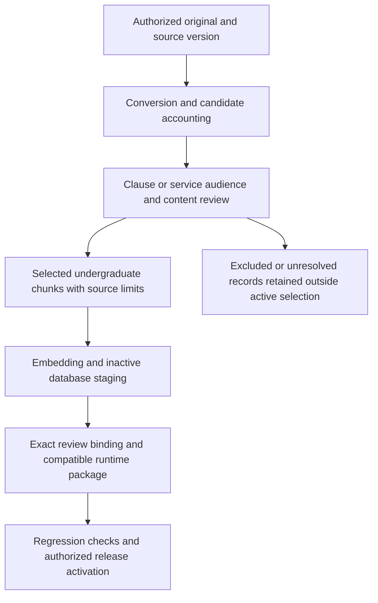

# New Handbook ingestion: current implementation and remaining work

26 October 2026. Read-only code/evidence assessment on Phase 11 base `0809cdb`.
Answers the ingestion question carried by the [session handoff](2026-10-25-phase11-session-handoff.md).
No new pipeline implementation, source selection or activation is authorized by this assessment.

## Answer

Researchers should be able to run a repeatable update workflow for a new authorized
Handbook edition. The intended sequence already appears in master sections 3.1,
7–9 and 18.3. Today, adding a PDF and running the candidate ingestion command is
**not enough to make its undergraduate content available to students**.

The processing and release components exist, but their current composition still
uses manually prepared readings, source mappings, receipts and package-specific
scripts. AI assistance has helped prepare and inspect those artifacts. It is not
a built-in autonomous source reviewer or a replacement for the recorded decisions.

## What the code actually does

Paths below are relative to the repository root; they identify existing components,
not a claim that one command connects all stages.

| Stage | Existing implementation | Input or limitation that remains |
| --- | --- | --- |
| Preserve/register a version | `document_ingest/register.py`, `bintanong_storage/source_registration.py`, `source_acquisition.py` | Explicit source metadata, original bytes and acquisition evidence. Byte identity does not establish institutional authority/currentness. |
| Convert and account | `document_ingest/__main__.py`, `pipeline.py`, `report.py` | CLI requires root/output/locator/classification. Produces hash-bound **candidate-only** bundles; source/content/scope/effectivity review remains pending. Accounting covers converter items, not independently proven extraction completeness. |
| Record audience and field decisions | `document_ingest/reviewed_policy.py` | Validates supplied readings and partitions undergraduate/excluded/unresolved. Audience and applicability are caller-supplied decisions; it does not infer their truth from a PDF or review-event hash. |
| Build source-linked chunks | `reviewed_native_spans.py`, `reviewed_image_spans.py`, `reviewed_policy_chunks.py`, service/record/flowchart binders | Requires reviewed values and source geometry/mappings. Withholds unsupported selections; supports explicit source limits and required companions. Does not grant approval or activation. |
| Embed | `bintanong_embedding/adapter.py`, `batch.py` | Model/token/config checks and resumable artifacts exist. Caller must choose eligible reviewed material. The generic runner is not an audience-review gate. |
| Stage in DB | `bintanong_storage/loader.py` | Validates chunk/vector identities and loads inactive artifacts through administrative RPCs. A stored row is not automatically a published answer source. |
| Bind review | `source_partial_review.py`, `source_supplementary_review.py`, `selected_release_review.py` | Exact source/field/event/span and selected chunk receipts. Initial selected-field review and cumulative supplementary review are distinct; published history is preserved. |
| Release/rollback | `bintanong_storage/release.py`, corresponding SQL migrations | Draft creation, selected-review binding, research designation and activation are separate calls. Research authorization preserves actual source states; it is not institutional approval. |
| Make topics usable at runtime | `bintanong_runtime/research.py`, `hosted_storage.py` | Composition uses the package's subject catalogue, claim reviews, chunks and configuration. Hosted membership must match the package. DB insertion alone does not update this catalogue or package. |

`backend/bintanong_tools/ingest.py` is another PDF conversion entrypoint; it does
not supply the missing reviewed-source-to-release orchestration either.

Supabase provides database functions callable through RPC and access controls;
the review and release semantics above are Bintanong's application logic, not an
automatic Supabase PDF-publication feature. Official references checked through
Context7 and the [database functions guide](https://supabase.com/docs/guides/database/functions)
and [API security guide](https://supabase.com/docs/guides/api/securing-your-api).

## How undergraduate exclusions apply

Keep the complete original PDF and raw conversion. Apply audience decisions to
clauses or complete logical services when deriving supported knowledge; do not
delete original pages or rely on matching words such as "dean", "staff" or "Law".

- Include verified undergraduate academic-affairs content, including shared
  services and the staff actions needed to complete a student transaction.
- Exclude faculty/staff-only, laboratory-school, graduate-only, Medicine and Law
  professional-program procedures from the supported selection. Undergraduate
  Nursing and Health Sciences remain in scope.
- Separate undergraduate-applicable clauses on mixed pages. A shared
  undergraduate/School of Law heading remains original provenance; it does not
  authorize Law support. Unknown applicability stays unresolved.
- Preserve conditions, penalties, explicit shared fees, agency-action/time/person
  associations and required companion context across page breaks. A blank stays
  unspecified; a cutoff stays a gap. Retain conflicts rather than choose precedence.
- Apply standing approve-as-printed delegation to equivalent clear readings and
  ordinary blanks, with that basis recorded. New ambiguity, defects or conflicts
  require the focused original-region review already required by repository policy.

The current validators enforce these declared partitions and bindings. They do
not prove that a caller correctly understood every audience or policy field.
The 511-page inventory and 89-group catalogue remain discovery/accounting evidence,
not complete field review or authorization to activate all discovered material.

## What remains for repeatable maintenance

The missing capability is a supported, tracked workflow connecting the existing
pieces for an arbitrary new edition. It needs explicit review inputs and resumable
stages, rather than dependence on a coding agent reconstructing package-specific
paths and decisions. A new edition must bind decisions to its own bytes/locators;
old page numbers, scope labels and approvals cannot simply be copied across.

Following the existing master 18.3, that workflow would prepare a review package,
record applicable decisions, build only the reviewed selection, embed/stage it,
assemble matching topic/claim metadata and rule links, verify it, then activate an
authorized release with rollback retained. Source changes affecting executable
rules need rule re-review. Embedding a clause does not compile it into Prolog.

A reusable new-edition comparison/review planner and a complete automated route
from fresh PDF to verified runtime package were not established by this audit.
AI may propose scope labels and extraction corrections, but final records must
distinguish AI suggestions, standing delegation, fresh human decisions and holds.
This describes the maintenance gap; it is not approval of a new feature/phase plan.

## Evidence and validation

- Consulted thesis physical 17–18 and 39–44, runtime routing PNG, master 3/7–9/16/18.3,
  Phase 11 plan/checkpoint and Phase 10 handoff, scope/gap policies and owner ledger.
  Keep the settled unknown-versus-unmet semantics; the thesis's illustrative
  closed-world example does not replace current missing-fact handling.
- Inspected existing ignored `p11-chunk-corrections-20261026/` build/receipt/encode/stage
  helpers and `p11-companion-context-20261026/release_switch.py`. They hard-code
  prior packages, selected release IDs/counts and evidence paths; they are evidence
  of the delivered composition, not a general fresh-edition CLI. None was executed.
- Fresh focused check: shared Python 3.13, `-X utf8 -B -m pytest -q -p no:cacheprovider`
  on `tests/test_ingestion_report.py`, `tests/test_reviewed_policy_preparation.py`,
  `tests/test_reviewed_policy_chunks.py`, `tests/test_storage_selected_release_review.py`:
  **77 passed, 110 subtests passed, 31.94s, exit 0**. Initial attempt had 21 setup
  errors from a missing basetemp parent; creating that parent resolved them.
- Evidence: workspace `audit-evidence/p11-ingestion-trace-20261026/focused-tests.log`
  and `.exit`; external basetemp under that directory. Synthetic tests do not
  establish real new-edition ingestion accuracy or fresh hosted release health.
- Documentation-only assessment: no artificial RED/GREEN, full-suite repeat or
  new live-model experiment. No source, production code, SQL, vector, release or
  dependency change. The inherited two natural grading failures remain unresolved.
