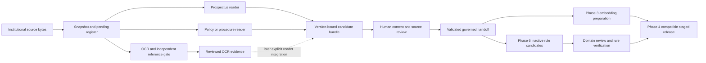

# Shared institutional ingestion boundary — written design draft

Status: written design presented2026-10-10; owner continuation2026-10-11 used to prepare the separate IMPLEMENTATION_PLAN.md for confirmation. Owner authorized the alignment report corrections and isolated implementation on2026-10-11. This architectural design is not a formal Phase2 start, adoption, release or institutional approval.

## Intent and smallest coherent approach

Unify the institutional preparation workflow and downstream contracts, while retaining document-specific readers. Reuse the prospectus extractor and the new document_ingest modules. Avoid a replacement extractor, plugin framework, new dependency or second source-of-truth schema.

The owner requests faster progress toward 90–95%, essential verification before local draft commits, deeper human/automated validation later, and one pipeline usable by subsequent phases. Those targets do not change the completion denominator or confer authority on candidate output.

Options considered: (1) rewrite every reader behind a new framework; too much migration risk; (2) concatenate existing outputs; loses version, review and publication boundaries; (3) retain readers and add a thin, checked institutional candidate boundary. Select option 3. Private uploads share parsing utilities only; they have a separate lifecycle and output capability.

## Source precedence and refreshed references

Let M denote C:/Users/Hawksprey/source/repos/Bintanong-wt/integration-fin/plans/master_implementation_plan_original_long.md. Let T denote integration-fin/Context/bintanong_thesis_for_context.pdf, with physical PDF pages rather than printed labels. Let A denote the owner's exact C:/Users/Hawksprey/source/repos/Bintanong/Context/bintanong_full_runtime_routing_architecture.png.

M:10–23 establishes U > D > T and the current architecture's precedence over older thesis routing. M:84–95 separates ingestion preparation, embeddings/storage, and rule authoring; those outputs later meet in a compatible knowledge release. M:142–157 gives phase dependencies. T:17–20 and 55–56 distinguish authorized institutional sources and isolated supplemental student uploads. A shows adaptive routing into RAG, symbolic and hybrid paths, followed by integration and validation; its ingestion arrow does not authorize executing extracted rules.

M:278–307 requires registration before conversion, reviewable extraction, stable provenance, OCR measurement and manual references. M:311–334 reserves exact tokenizer accounting and approved-chunk embedding for Phase 3. M:346–367 reserves versioned storage and atomic activation for Phase 4. M:413–453 requires reviewed rule specifications, applicability, bounded symbolic execution and rule-level tests. M:613–619 and 636–642 requires bounded private processing, deletion and failure/restart recovery. M:355 prohibits institutional storage of private academic context. M:659 supports researcher CLI jobs as the initial operational surface.

T:65–67 supports advisory use and no academic-record persistence. T:68–71 describes source-grounded evaluation and at least 50 queries across five categories. T:75–79 describes issuing-office approval, preparation and the intended stack. Contradictions remain explicit: T:67's authorization prose conflicts with T:75–76; T:77's broad storage prose conflicts with T:65. Follow M's stricter authorization and privacy requirements; do not turn either thesis passage into a legal conclusion.

All 18 requested physical pages were reread; pages 55, 65, 75 and 79 were also rendered and inspected. source_reread/SOURCE_READ_MAP.json records source hashes and captures. Refresh these references when changing trust boundaries, source/review contracts, Phase 3/4/6 handoffs, private lifecycle or runtime wiring; record any discrepancy before implementation.

## Current implementation and remaining bridges

Current candidate checkout: C:/Users/Hawksprey/source/repos/Bintanong-wt/phase2-candidates-20261010. Paths below are relative to it.

| Boundary | Existing evidence | Remaining work |
| --- | --- | --- |
| Immutable input and source registration | prospectus_extractor/identity.py; document_ingest/register.py:12–89 mints/reparses pending byte-derived versions before conversion | Prospectus wrapper must bind the same governed version; reviewed-register ingestion is a separate future path |
| Prospectus extraction | prospectus_extractor/pipeline.py:55–207 builds structured courses, audit, candidate clauses and chunks | Governed wrapper and field-level review binding; F scratch changes have not been adopted |
| Institutional PDF/PPTX preparation | document_ingest/pipeline.py:19–83 verifies conversion identity/artifact hashes and publishes a root manifest last | No prospectus adapter in this orchestrator; PPTX has report-only slide evidence until locator contracts support it |
| Common chunk contract | backend/bintanong_contracts/chunk_adapter.py:75–158 maps legacy chunks without editing input; document_ingest/policy_chunks.py produces governed policy chunks | Prospectus adapter currently emits null document/version/edition IDs and span version IDs; bind and revalidate at a new boundary without recomputing existing chunk IDs |
| OCR | document_ingest/ocr_run.py and ocr_gate.py capture actual engine metadata and score independent manual references | Gate-only path; no automatic OCR-to-policy-chunk integration or completed ten-document/phone-photo validation |
| CLI | document_ingest/__main__.py:14–39 provides an explicit candidate command | Thin dispatch may be added after approval; generic ingest and F CLI edits cannot be adopted as whole-file replacements |

The root manifest's complete flag means a technically complete candidate bundle. It does not mean office approval, reviewed content, usable embeddings, executable rules or an active knowledge release. Current load_pending_register deliberately refuses promoted states: an approved register cannot be passed into this current preparation API unchanged.

## Proposed institutional flow

1. The caller explicitly selects institutional preparation, input root, logical acquisition locator, document classification and a new external output folder. No routing inference from filename, upload contents or an LLM. Capture input bytes once and verify their digest before conversion and before publication.
2. Reuse pending_version/load_pending_register for draft preparation. Duplicate bytes are one version with acquisition aliases; a genuinely different edition remains a separate version. Never infer campus, program, issuer, edition authority or supersession from a filename. A future reviewed-source entry point must preserve existing IDs and validate its evidence through the governance contracts; do not relax the pending-only helper to sneak promotion through conversion.
3. Dispatch to existing readers with explicit classification and installed conversion settings. Prospectus remains structured-course extraction; policies retain clause order; procedures retain requirements, fees and steps; forms and unsupported tables remain review artifacts. Explicit partial/failed conversion is a failure, even with surviving text. No paraphrasing or fabricated spans.
4. Bind every prospectus candidate chunk and field-level rule input to the selected SourceDocumentVersion and actual source spans. Reparse typed contracts; require byte SHA, edition/version agreement, valid locators, geometry and exact source-text correspondence. Preserve content hashes and existing chunk IDs. Verify the complete binding before any write. Preserve M01's strengthened pre-write invariant when adopting the pinned F work; the historical 52/52 mutation claim remains unproved.
5. Reuse the existing candidate artifact convention: captured raw conversion plus settings/digests, source register, structured candidates, chunks, accounting/review report and completion manifest. Keep curriculum fields and policy/procedure fields in their existing artifacts rather than forcing a universal content schema. Prospectus-specific field decisions remain available alongside these artifacts. Write the root completion manifest last and keep partial runs unconsumable.
6. Review creates explicit source/content/scope decisions tied to the same version and source evidence. Corrections require a new derived candidate plus decision ledger and hashes; they must not overwrite the captured raw conversion or silently amend the original PDF. Rejections, unresolved prerequisites, omitted spans, unsupported tables and OCR uncertainty remain visible blockers. A chunk cannot confer approval on its own source.
7. A small downstream loader, added only when an actual consumer needs it, validates the expected artifact set, safe relative paths, digests, schema versions, register membership and chunk/span bindings. Reject absent or incomplete root manifests, private namespaces, stale settings, cross-version spans and unsafe paths. Reuse governance validation; no new signing service or approval framework. Review evidence must be checked separately from manifest integrity.
8. Phase 3 consumes only eligible reviewed institutional chunks and performs exact counts using its pinned tokenizer, prefix and special-token policy. Today's estimate-v1 and 480 estimate cap are not proof of the 512-token limit. Phase 4 stages compatible source/chunk/embedding/rule versions and activates only through its separately approved release workflow. No ingestion command activates a release.
9. Phase 6 receives source-bound curriculum/policy evidence, not retrieved prose treated as law. Reuse the legacy generator only behind the separately drafted phase6_prologifier/SPEC.md boundary. Candidate clauses are strings in inactive JSON; unresolved OR/corequisites/standing/exceptions block compilation. No .pl export, Janus execution or routing change in this preparation path. Existing prospectus pipeline.py:264–299 can export .pl when requested: a unified institutional wrapper must explicitly disable that export and must never use it as its downstream handoff.

## Private upload boundary

Private grade sheets, student prospectuses and phone photos do not enter the institutional register, candidate bundle, chunks, embedding jobs, rule ledger or release. They can reuse pure parsing helpers, but the future private worker must own isolated conversion, bounded memory/transient storage, sanitized errors and deletion on completion, expiry, failure and restart. Separate namespaces alone do not solve retained-file recovery.

The current session draft has an independently confirmed High Windows cleanup defect. The earlier same-process retry proposal cannot guarantee the master's lifecycle contract and is not approved. This design therefore does not present private uploads as production-ready or unify them with institutional outputs. A lifecycle design remains separate owner review work.

## Interruption and retry behavior

Consumers accept only a complete root manifest after all identity and hash checks. Partial conversion folders are diagnostic evidence, not a successful bundle. Retry into a new output folder using the same verified source bytes and settings; record a distinct run rather than reusing stale partially published files. Before introducing resume or deduplication, validate source, settings and every artifact again. No distributed queue, database or new service is needed for the current researcher CLI workflow.

## Verification that remains essential

Each implementation batch retains focused tests for its changed boundary and a local draft commit after passing checks. Minimum unified-boundary cases: normal policy and prospectus bundles; changed input/digest or cross-version spans; partial conversion; malformed/escaping manifest; unsupported evidence accounted rather than dropped; interrupted publication rejected; prior output preserved; private namespace refused; unresolved prerequisites retained; no .pl publication. Reuse existing tests where they already exercise these cases. Independent Spec then Standards review remains separate from implementation acceptance.

At a stable freeze, run one combined synthetic integration smoke rather than repeatedly running all ~4,000 tests after each narrow edit. Original-corpus validation, office/domain review, ten independent OCR references, actual phone-photo measurements, deep mutation testing and broad automated checks remain explicitly scheduled later. Deferring them saves time; it does not remove them from full completion.

## Progress and approval boundary

Report three different quantities: accepted Phase 1 software exit, Phase 2 prepared implementation coverage, and whole validated ingestion completion. Keep the existing overall weights and do not count this unimplemented bridge as delivered. The independent refresh report supplies percentages from current evidence. A 90–95% software coverage target may be reachable before institutional/human/OCR/private-lifecycle closeout; full validated completion cannot be assigned that percentage merely because draft code is committed.

Current gate: the owner explicitly authorized implementing plan_alignment_20261011/REPORT.md, including its two plan corrections. The written plans and already selected separate-subagent execution method govern execution. Historical extractor Phase1 is not master Phase1 governance: this bridge is governed institutional ingestion under master Phase2. Use existing bind_chunk/check_chunk_binding after strict prechecks; preserve byte/version identity invariants. The shared checked bundle exposes structured payload/raw conversion to the explicit Task3 field-evidence bridge; no whole-chunk evidence substitution. Formal Phase 2 start, adoption/merges, API/Docker work and institutional use retain their applicable approvals.
